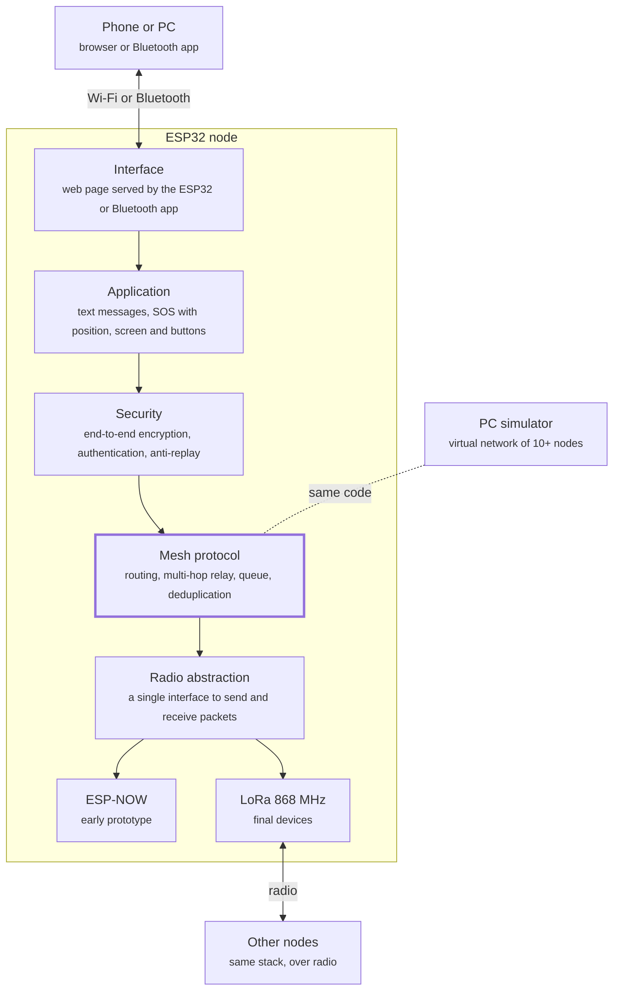
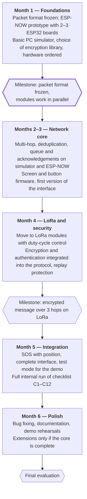

# Open Project Specification — Emergency Mesh Network

> Draft — 20 November 2026

## Overview and goals

We are building an emergency messaging network that works without internet or a cellular network. Small ESP32 devices with LoRa radios form a mesh network: every node relays the other nodes' messages, so a message reaches its destination by hopping from device to device.

**The problem.** During a blackout, a flood or an earthquake, the cellular network and the internet can go down exactly when they are needed most. People in the area are left with no way to ask for help or coordinate.

**Measurable goals**

- Text messages delivered between two nodes without any infrastructure
- Delivery across at least 3 hops through intermediate nodes
- Messages stored and delivered when an unreachable node comes back online
- End-to-end encrypted messages: an intermediate node relays but cannot read
- An SOS message with position that takes priority over all other traffic
- A reproducible live demo during evaluation, with Wi-Fi switched off

**Out of scope:** voice, images, file attachments and any use in real emergencies. This is an educational prototype, not a certified device.

## Context and existing solutions

The idea already exists in several forms: our contribution is to design and implement the protocol from scratch, document it, and make it verifiable with a simulator.

| Solution | Type | What it does | How we differ |
| --- | --- | --- | --- |
| Meshtastic | Open-source firmware | LoRa mesh on ESP32 and nRF52, messages and positions | Similar hardware, but we write the protocol ourselves |
| Briar | Android app | Peer-to-peer messaging over Bluetooth, Wi-Fi and Tor | No smartphones as nodes: the network is made of dedicated devices |
| goTenna | Commercial product | Radio devices for off-grid communication | Open, documented protocol instead of a proprietary one |
| FidoNet | Historic network (1980s) | Store-and-forward between BBSs over modems | Same queue-and-relay idea, applied to a dynamic radio network |

Writing the protocol from scratch forces us to solve the real problems: routing in a changing network, minimal radio bandwidth, loops and duplicates.

## Architecture and technologies

Each node is a stack of layers: the mesh protocol sits in the middle and does not know which radio is underneath, so the same code runs on ESP-NOW, on LoRa and in the simulator.

- **Language:** C/C++ for firmware and protocol; the simulator compiles the same protocol code on a PC
- **Framework:** PlatformIO with ESP-IDF or the Arduino core for ESP32, to be decided together
- **Radio:** ESP-NOW for the prototype using the ESP32 boards already available, LoRa at 868 MHz (SX1262 or SX1276 modules) for the final devices
- **Encryption:** a well-established library, e.g. libsodium or mbedTLS, chosen in the first month
- **Interface:** a web page served by the ESP32 or an app connecting over Bluetooth

## Features

Features are split into a mandatory core, on which we ask to be evaluated, and optional extensions that do not block the project if they are not completed.

**Mandatory core**

| ID | Feature | Module |
| --- | --- | --- |
| N1 | Sending and receiving short text messages between two nodes, without infrastructure | Protocol |
| N2 | Multi-hop relay across at least 3 hops | Protocol |
| N3 | Deduplication and loop prevention (message ID + maximum hop count) | Protocol |
| N4 | Store-and-forward: message queue for temporarily unreachable nodes | Protocol |
| N5 | End-to-end delivery acknowledgement | Protocol |
| N6 | End-to-end encryption and message authentication | Security |
| N7 | Interface to write and read messages (web page served by the ESP32 or Bluetooth app) | Interface |
| N8 | Priority SOS message with position | Firmware + Protocol |
| N9 | Device firmware: screen, buttons, network status | Firmware |
| N10 | Swappable radio layer: the same protocol runs on ESP-NOW and on LoRa | Protocol + Firmware |
| N11 | PC network simulator using the same protocol code | Testing |

**Optional extensions**

| ID | Extension |
| --- | --- |
| E1 | Gateway to the internet when a node has connectivity |
| E2 | Real-time map of nodes and routes |
| E3 | Power consumption measurement and battery life estimate |
| E4 | 3D-printed case for the handheld device |
| E5 | Fixed node with an environmental sensor that raises alerts on the network |

Open question: the maximum message length will be set after the first radio tests (roughly 150 characters, given the space taken by header and encryption).

## Operational requirements

Five nodes are needed to demonstrate multi-hop; Emma pays for the hardware up front and it stays at school for the whole project.

| Component | Quantity | Notes |
| --- | --- | --- |
| ESP32 | 5 | 2–3 already available |
| LoRa module 868 MHz (SX1262 or SX1276) | 5 | European band, never 433 or 915 MHz |
| 868 MHz antenna | 5 | Never transmit without an antenna attached |
| OLED screen + buttons | 3 | For handheld nodes |
| LiPo battery + charging module | 3 | For handheld nodes |
| GPS module | 1–2 | For SOS with position |
| Connectors, breadboard, multimeter | — | Already available |

**Budget:** about €150–200 (estimate, to be confirmed with actual prices), paid up front by Emma.

**Development tools:** C/C++ with PlatformIO or ESP-IDF, Git with peer code review, the PC simulator to test the protocol without hardware.

**Demo environment:** a classroom at 42 Firenze. A test mode forces nodes to ignore their direct neighbours, so multi-hop is visible even when all nodes can hear each other.

## Legal aspects and constraints

The project transmits over radio, encrypts messages and handles people's positions: each of these comes with a constraint, and the project complies with it by design.

| Area | Constraint | How we comply |
| --- | --- | --- |
| Radio frequencies | The 868 MHz band is licence-free for short-range devices, with limits on power and channel occupancy (duty cycle, typically 1%) | Power within limits and duty-cycle control in the firmware |
| CE conformity | Radio Equipment Directive 2014/53/EU | We use commercial modules that are already compliant; the prototype is not placed on the market |
| Cryptography | Use is unrestricted in the EU | Only well-established libraries, no home-made algorithms |
| Privacy (GDPR) | Messages and positions are personal data | Tests only among team members, no plaintext logs, data deleted at the end of the project |
| Licences | Compliance with the licences of the libraries we use | Code released as open source under a compatible licence, chosen together |
| Emergency use | A prototype cannot guarantee message delivery | Clear notice: the system does not replace emergency services (112) |

To verify before validation: the exact sub-band and the precise power and duty-cycle limits under the national frequency allocation plan.

## Team organisation

Work is split into independent modules: the core depends on protocol and hardware, the other modules build on a defined interface and do not block the rest.

| Role | Person | Modules | Features |
| --- | --- | --- | --- |
| Lead, protocol and hardware | Emma | Mesh protocol, radio abstraction interface, SOS priority queue, hardware assembly | N1–N5, N8 (protocol), N10 (interface) |
| Device firmware | TBD | ESP-NOW and LoRa drivers, duty-cycle control, screen, buttons, Bluetooth, GPS | N8 (device), N9, N10 (drivers) |
| Security | TBD | Encryption, authentication, replay protection, security tests | N6 |
| Interface | TBD | Web page or app, visualisation extensions | N7, E1, E2 |
| Testing and integration | TBD | PC simulator, automated tests and CI, simulator scenarios, checklist runs | N11, C1–C12 |

Shared features are split along the radio abstraction: the lead defines the interface that the protocol uses, and the firmware role implements the ESP-NOW and LoRa drivers behind it. The simulator is a third implementation of the same interface, owned by testing and integration.

**How we work**

- A team Slack channel and a short weekly meeting
- A single Git repository, with every change reviewed by another member through a pull request
- Open decisions are discussed in repository issues, one per topic
- The packet format is frozen within the first month, so modules can be developed in parallel

Weekly commitment is flexible by role: the core needs more hours, the extensions fewer.

## Planning

The project lasts 6 months from the validation of this specification; the start date will be decided together.

The first milestone is the most important: until the packet format is frozen, security and interface cannot move forward on their own.

## Risks and mitigations

| Risk | Impact | Mitigation |
| --- | --- | --- |
| Very limited radio bandwidth | Few messages per minute | Short messages, no multimedia, priority queue |
| All nodes hear each other in a classroom | Multi-hop is not visible | Test mode that forces relaying through intermediate nodes |
| A member slows down or leaves the team | Modules fall behind | Independent modules; extensions can be dropped without touching the core |
| Hardware late or faulty | Development blocked | PC simulator and ESP-NOW prototype with the ESP32 boards already available |
| Encryption mistakes | Security only on paper | Well-established libraries and dedicated security tests |
| Scope too large | Project not finished in 6 months | Checklist limited to the core; new ideas stay as extensions |

## Final evaluation checklist

The final evaluation checks these requirements one by one with a live test. Extensions are not part of the checklist.

| ID | Requirement | How it is verified |
| --- | --- | --- |
| C1 | Two nodes exchange a message without Wi-Fi or cellular network | Wi-Fi off, the message appears on the other screen |
| C2 | A message travels across at least 3 hops | Test mode on, the route is shown on the destination node |
| C3 | No duplicated or looping messages | Ring network, every message arrives exactly once |
| C4 | A message for a switched-off node arrives when it is switched back on | Turn off the destination, send, turn it back on |
| C5 | The sender receives a delivery acknowledgement | The acknowledgement appears on the sending node |
| C6 | An intermediate node cannot read the content | Show the packet captured on the intermediate node: it is encrypted |
| C7 | A tampered or replayed message is discarded | Resend a captured packet: the node rejects it |
| C8 | A message can be written and read from the interface | Live use of the web page or app |
| C9 | An SOS with position overtakes other messages | Full queue, the SOS arrives first |
| C10 | The same protocol works on ESP-NOW and on LoRa | Same demo with both radio types |
| C11 | The simulator runs a network of at least 10 nodes | Run the simulator and its tests |
| C12 | Power and duty cycle stay within legal limits | Show the settings in the code and the duty-cycle counter |